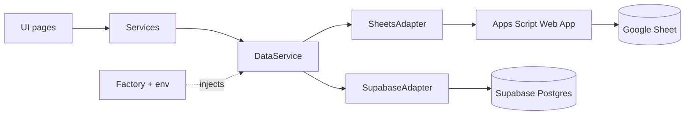

# google-apps-script-demo

Equipment management web app with hierarchical categories, maintenance history and audit fields (created/modified time and user). English and Vietnamese UI, responsive on desktop and mobile. Data lives in Google Sheets (through an Apps Script Web App) or Supabase; switching is a config change only.

## Architecture



## Repo layout

```
frontend/              Vite + React + TypeScript app (src, docs)
backend/
  apps-script/         Apps Script API (clasp project, src/)
  supabase/migrations/ SQL: schema and RLS policies
  docs/                backend docs
.github/workflows/     GitHub Pages deploy
CLAUDE.md              project rules
```

## Quick start (frontend)

1. `cd frontend`
2. Create a `.env` file with the variables below (never commit it).
3. `npm install`
4. `npm run dev`

| Variable | Purpose |
|---|---|
| `VITE_DB_PROVIDER` | `sheets` or `supabase` |
| `VITE_SHEETS_API_URL` | Sheets provider: data API URL (requests carry a Google ID token, see [auth](frontend/docs/auth.md)) |
| `VITE_IDENTITY_API_URL` | Sheets provider: [identity-api](backend/docs/identity-api.md) URL |
| `VITE_GOOGLE_CLIENT_ID` | Google login (all providers); public value |
| `VITE_SUPABASE_URL`, `VITE_SUPABASE_ANON_KEY` | Supabase provider |
| `VITE_BASE_PATH` | Vite base path (default `/`) |

Other scripts: `npm run build`, `npm run lint`, `npm test`.

## Backend setup

**Google Sheets (Apps Script)**
1. `npm i -g @google/clasp`, then `clasp login`.
2. In `backend/apps-script`, run `clasp push`.
3. Set up [identity-api](backend/docs/identity-api.md) first (own spreadsheet, `GOOGLE_CLIENT_ID`, `SPREADSHEET_ID`, first admin by hand). Then in the Apps Script editor of `backend/apps-script` set script properties `GOOGLE_CLIENT_ID`, `IDENTITY_API_URL` and `SPREADSHEET_ID`.
4. Deploy as a Web App: execute as `Me`, access `Anyone`. Create a new version after each push.
5. Put the Web App URL in the frontend `.env`.

Details: [backend/docs/apps-script.md](backend/docs/apps-script.md).

**Supabase**
Run `backend/supabase/migrations/001_init.sql` then `002_rls_policies.sql` in the SQL editor, then set the project URL and anon key in the frontend `.env`. Details: [backend/docs/supabase.md](backend/docs/supabase.md).

## Deployment

GitHub Pages via [deploy-pages.yml](.github/workflows/deploy-pages.yml) on push to `main`; Cloudflare Pages is planned. See [frontend/docs/deploy.md](frontend/docs/deploy.md).

## Security notes

- Every `VITE_*` value is embedded in the public bundle; treat them as public.
- v1 has no login: anyone with the app link can read and write data. The Sheets token only deters casual access and the Supabase policies grant the `anon` role full access.
- Never use a Supabase `service_role` key in the frontend.

## Project rules

Summary: ask when unclear, plan before non-trivial code, review before tests, commits only on request, SOLID and clean architecture, responsive UI, English-only artifacts. Full rules in [CLAUDE.md](CLAUDE.md).

## Documentation

- [Frontend docs](frontend/docs/README.md)
- [Backend docs](backend/docs/README.md)
