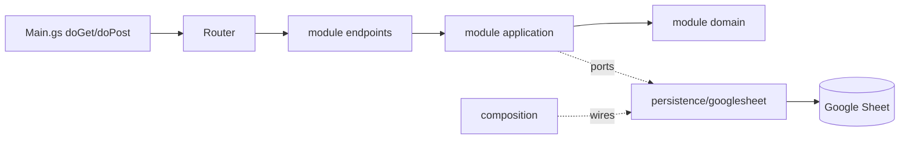

# Apps Script API

**Purpose:** JSON API over a Google Sheet. It is only an API layer and does not host the UI.

**Contract**
- `POST` with `Content-Type: text/plain` (avoids a CORS preflight). Body: `{ token, action, payload }`.
- Response: `{ ok: true, data }` or `{ ok: false, error: { code, message } }`. Codes: `NOT_FOUND`, `VALIDATION`, `UNAUTHORIZED`, `INTERNAL`.
- Actions are `<module>.<entity>.<action>` (e.g. `device-management.equipment.list`); see [device-management](device-management.md).
- Payloads use snake_case rows (as in `row-mappers.ts`). A bad or missing body, bad JSON, an unknown action or wrong field types return `VALIDATION`.
- `UNAUTHORIZED` maps to `AuthError` in the Sheets adapter (message `error.unauthorized`).
- Write actions take the script lock (20 s wait), so writes are serialized. Read actions (listed per endpoint in `readActions()`, passed to the `Router`) skip the lock.
- Sheets are created or upgraded under the lock, only when the stored `SCHEMA_SIGNATURE` script property differs from the current headers. After you change a schema the first request upgrades the tabs and stores the new signature; deleting a tab by hand needs that property cleared to be recreated.
- Parsed table rows are cached for 60 s in `CacheService` (`ScriptRowCache`) and cleared by every write through the app. Edits made directly in the Google Sheet can show up to 60 s late. Tables too large for one cache entry (about 100 KB) are read from the sheet each time.
- The spreadsheet is opened once per request.
- Table reads use the Sheets advanced service (`Sheets`, v4, enabled in `appsscript.json`): one `values.get` per read, no spreadsheet open. Pending `SpreadsheetApp` writes are flushed before such a read. Without the service the code falls back to `SpreadsheetApp`. The Sheets API must also be enabled in the Google Cloud project linked to the script.
- Ids are lowercase UUIDs, compared case-insensitively. Ordering, pagination and validation mirror the Supabase adapter.

**Architecture** (dependencies point inward: `endpoints`/`infrastructure`/`persistence` -> `application` -> `domain`)



- **domain:** pure rules and constants (`ApiError`, `AuditRules`, `IdRules`, module entities and values). No Google API.
- **application:** use cases and port contracts ([Ports.gs](../apps-script-shared-kernel-library/src/application/Ports.gs)). Time and ids come from the `Clock` / `IdGenerator` ports.
- **endpoints:** classes that turn payloads into use-case input; `RequestParser`, `Router` and `ResponseWriter`.
- **infrastructure:** generic port implementations (`ScriptSettings`, `ScriptLockGuard`, `ScriptRowCache`, `PropertiesTokenGuard`, `SystemClock`, `UuidIdGenerator`, `AnonymousCurrentUser`).
- **persistence/googlesheet:** everything that touches the spreadsheet: shared `SpreadsheetSource`, `SheetLayout`, `SpreadsheetTable`, `SheetUpgrade`, `SheetInstaller`, and per-module `*Service` classes in `modules/<m>/persistence/googlesheet`. A future Supabase backend would add a sibling `persistence/<provider>` folder.
- **composition:** [Composition.gs](../apps-script/src/composition/Composition.gs) is the only place that wires adapters to ports and builds the handler registry, all inside functions at request time.
- Modules talk only through ports implemented in persistence (for example category removal asks `EquipmentCategoryUsage`). No code reads another entity's sheet directly.
- Apps Script has one global scope and no imports: each module exposes one namespace root (`DeviceManagement.<Layer>.<Name>`), and file order is fixed by `filePushOrder` in [.clasp.json](../apps-script/.clasp.json).

**Folder map** (`backend/apps-script`, clasp `rootDir` is `src`)

```
.clasp.json
src/
  appsscript.json
  Main.gs                      entry points only
  SharedLibrary.gs             aliases for the SharedKernelLibrary library (loads first)
  composition/Composition.gs
  modules/<module>/
    domain/{entities,values}/  application/<feature>/{commands,queries}/
    endpoints/  persistence/googlesheet/
    <Module>Module.gs          namespace root (e.g. DeviceManagement)
tests/                         harness/, domain/, application/, endpoints/ (not pushed)
```

The shared building blocks (domain, application ports, infrastructure, `persistence/googlesheet`, `interface`) live in a separate Apps Script project used as a library: see [shared-library](shared-library.md). The app reaches it through the `SharedKernelLibrary` identifier.

`package.json` has `npm test`.

Shared code stays one file per class. Today the only module is [device-management](device-management.md).

**Add a module**
1. Create `src/modules/<name>/{domain,application,endpoints,persistence/googlesheet}` and a `<Name>Module.gs` namespace root that loads first in the module.
2. Register actions as `<name>.<entity>.<action>` in the module's `*Endpoints` classes.
3. Wire services, ports and deps in `Composition.gs` (handler registry and schema definitions).
4. Add every new file to `filePushOrder` in `.clasp.json` (namespace root first, dependencies before users, `Main.gs` last).
5. Add `backend/docs/<name>.md`.

**Audit columns** (all sheets): `created_at`, `modified_at`, `created_by`, `last_modified_by`.
- Filled by the server only; audit fields in payloads or patches are ignored.
- Create: `created_at = modified_at = now`. Update: `modified_at = now`, `created_*` untouched. Logs get `modified_at = created_at` on insert.
- `created_by` / `last_modified_by` are `''` until login exists. Later hook: return the user from [AnonymousCurrentUser](../apps-script-shared-kernel-library/src/infrastructure/AnonymousCurrentUser.gs).
- Datetimes are UTC, millisecond precision, `+00:00` instead of `Z` (e.g. `2026-10-16T08:00:00.123+00:00`), so string ordering is chronological. `performed_at` uses the same format.

**Sheets**
- `categories`, `equipment` and `maintenance_logs` are created on first call; headers match the Postgres columns. All cells use the plain text format and the grid grows when needed.
- [SheetUpgrade](../apps-script-shared-kernel-library/src/persistence/googlesheet/SheetUpgrade.gs) upgrades an older tab: adds missing columns, renames `updated_at` to `modified_at`, backfills `modified_at` from `created_at` and `*_by` with `''`. Existing values written with `Z` are kept as is.
- Legacy migration (equipment): see [device-management](device-management.md).

**Setup and clasp workflow**
1. Create a Google Sheet (empty; the tabs are created on the first call).
2. Set up the shared library first: see [shared-library](shared-library.md) (create it, push it, create a version, put its script id and version in `backend/apps-script/src/appsscript.json`).
2b. Install and log in yourself (the login is interactive and never scripted): `npm i -g @google/clasp`, then `clasp login`.
3. `cd backend/apps-script`, then `clasp push` (uploads `src/` in `filePushOrder`; the script id is in `.clasp.json`).
4. In the Apps Script editor: Project Settings > Script properties: set `API_TOKEN` (any long random string) and `SPREADSHEET_ID` (the id from the sheet URL; optional when the script is bound to the sheet).
5. Deploy > Manage deployments > New version (first time: Deploy > New deployment > Web app, execute as `Me`, access `Anyone`; authorize when prompted). `clasp push` alone does not change the live Web App; a new version is required after each change.
6. Copy the Web App URL into `VITE_SHEETS_API_URL` and the same token into `VITE_SHEETS_API_TOKEN` (see the frontend config docs).

**Testing**
- Zero dependencies: `node:test` and `node:vm`. Run `npm test` in `backend/apps-script` (60 cases).
- [loadAppsScript.js](../apps-script/tests/harness/loadAppsScript.js) loads the files listed in `filePushOrder` into one vm context (like Apps Script's global scope) and checks that the files on disk equal `filePushOrder`.
- [fakes.js](../apps-script/tests/harness/fakes.js) provides in-memory tables, a settable clock, sequential ids and the real `AuditStamper`.
- Suites: `tests/domain`, `tests/application` (use cases with fakes), `tests/endpoints`.
- Not covered (verify with a real `clasp push` and a run on Google): `doGet`/`doPost`, `RequestParser`, `ResponseWriter`, token and lock guards, `SpreadsheetTable`, `SheetInstaller`/`SheetUpgrade`, legacy migration.
- `tests/` is outside the clasp `rootDir` (`src`), so it is never pushed.

**Limits:** the token is visible in the frontend bundle, so it only deters casual access. Quotas and latency are higher than Postgres.
