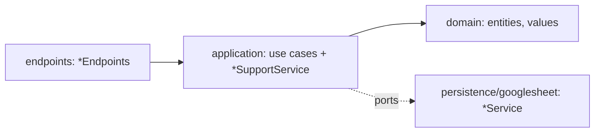

# Device management (Apps Script)

**Purpose:** one module for equipment, its hierarchical categories and maintenance logs. It replaces the former `category`, `equipment` and `maintenance` modules. Entities inside the module reach each other through ports, never through another entity's sheet.

**Layout** (root: [modules/device-management](../apps-script-device-api/src/modules/device-management), namespace `DeviceManagement.<Layer>.<Name>`, declared in [DeviceManagementModule.gs](../apps-script-device-api/src/modules/device-management/DeviceManagementModule.gs))

- `domain/entities` (`Equipment`, `Category`, `MaintenanceLog`), `domain/values` (`EquipmentCriteria`).
- `application/<feature>/{commands,queries}`: one file per use case, named after the action (`CreateEquipment`, `ListEquipment`, `AddMaintenanceLog`...); `EquipmentSupportService` and `CategorySupportService` hold shared steps.
- `endpoints`: `EquipmentEndpoints`, `CategoryEndpoints`, `MaintenanceLogEndpoints`.
- `persistence/googlesheet`: `EquipmentService`, `CategoryService`, `MaintenanceLogService`, `EquipmentLegacyMigrationService`.
- Naming: models have no suffix, use cases are named after the action, other classes carry a role suffix.

**Actions** (`device-management.<entity>.<action>`)

| Action | Payload |
|---|---|
| `device-management.equipment.list` | `page?`, `pageSize?`, `status?`, `categoryIds?`, `search?` |
| `device-management.equipment.get` | `{id}` |
| `device-management.equipment.create` | `{category_id?, name, description?, status?, quantity?, purchase_date?, warranty_months?, note?, vendor?}` |
| `device-management.equipment.update` | `{id, patch}` |
| `device-management.equipment.remove` | `{id}` |
| `device-management.category.list` | none |
| `device-management.category.get` | `{id}` |
| `device-management.category.create` | `{parent_id?, name}` |
| `device-management.category.update` | `{id, patch:{parent_id?, name?}}` |
| `device-management.category.remove` | `{id}` |
| `device-management.maintenance.listByEquipment` | `{equipmentId}` |
| `device-management.maintenance.add` | `{equipment_id, type, performed_at?, note?, vendor?}` |

Renaming the actions is a breaking change: deploy the frontend and the Apps Script version together.

## Equipment

Tab `equipment`: `id`, `category_id`, `name`, `description`, `status`, `quantity`, `purchase_date`, `warranty_months`, `warranty_expiry_date`, `note`, `vendor`, audit columns.
- Optional fields (nullable; blank strings and empty cells read as `null`): `purchase_date` (real date `YYYY-MM-DD`, future allowed), `warranty_months` (integer 0..600, requires `purchase_date`), `note` (max 2000, ends trimmed, newlines kept), `vendor` (seller, max 200). `warranty_expiry_date` is derived server-side (purchase date + months, clamped to month end, UTC date-only; null without months), recomputed on every create/update, never accepted from clients. Rules live in `WarrantyPeriod` / `OptionalText` value objects.
- Validation codes (as `VALIDATION` message): `purchase_date_invalid`, `warranty_months_invalid`, `warranty_requires_purchase_date`, `note_too_long`, `vendor_too_long`.
- `list`: `page >= 1`, `1 <= pageSize <= 100` (a missing, zero or non-numeric `pageSize` becomes 20; negative becomes 1; above 100 becomes 100). A page past the end returns no items and the correct `total`. Order: `modified_at` DESC, then `id` ASC.
- Filters: `status`; `categoryIds` (array of uuid strings matching `category_id`; empty or missing means no filter, a non-array is `VALIDATION`; the backend does not expand descendants, so the client or service must send every category id of the subtree); `search` (trimmed, `, ( ) % _ \` replaced by spaces, matched case-insensitively on `name` and `description` separately). See [EquipmentCriteria](../apps-script-device-api/src/modules/device-management/domain/values/EquipmentCriteria.gs).
- Create defaults: `status = active`, `quantity = 1`, `description = ''`. Statuses: `active`, `in_repair`, `retired`. `quantity` is an integer >= 0.
- `name`, `description` must be strings and are stored trimmed; `name` is required. Shape errors win over the category lookup.
- `category_id` `''` or null = uncategorized; a non-empty id that is malformed or missing is `NOT_FOUND`; the stored id is normalized.
- Malformed or unknown ids: `get` returns `null`; `update` and `remove` return `NOT_FOUND`.
- Remove deletes the equipment's logs first, then the row (mirrors `ON DELETE CASCADE`).
- Legacy migration: a tab with the old text `category` column gets one root category per distinct non-empty name (trimmed, case-insensitive; existing roots are reused), `category_id` is filled, then the header is renamed. Runs on the next call, before the sheet upgrade; reruns are safe. See [EquipmentLegacyMigrationService](../apps-script-device-api/src/modules/device-management/persistence/googlesheet/EquipmentLegacyMigrationService.gs).

## Category

Tab `categories`: `id`, `parent_id` (`''` = root), `name`, audit columns.
- `list` has no paging: sorted by `name` case-insensitively, then `id`. `get` returns the row or `null`.
- Name is required, trimmed, and unique among siblings case-insensitively. `null` in a patch clears `parent_id`/`name` to `''`.
- A `parent_id` that is malformed or missing is `NOT_FOUND`. A category cannot be its own parent or sit under its own descendant.
- Remove is blocked while the category has children or equipment uses it (mirrors `ON DELETE RESTRICT`).
- There are no separate error codes for these cases: all of them are `ApiError.validation(message)`, so callers tell them apart by the message. Remove throws `category_has_children` first, then `category_in_use`.
- Stable `VALIDATION` messages: `category_name_required`, `category_name_duplicate`, `category_cycle`, `category_in_use`, `category_has_children`, plus `name must be a string`, `parent_id must be a string`, `patch must be an object`.
- Rules live in [Category](../apps-script-device-api/src/modules/device-management/domain/entities/Category.gs).

## Maintenance log

Tab `maintenance_logs`: `id`, `equipment_id`, `type`, `performed_at`, `note`, `vendor` (nullable service provider, max 200, `vendor_too_long`), audit columns.
- `listByEquipment` returns the logs of the (case-insensitive) equipment id, ordered by `performed_at` DESC then `id` ASC; an unknown or malformed id returns an empty list, not `NOT_FOUND`.
- Payload key asymmetry (current limit): `listByEquipment` reads `equipmentId` (camelCase) while `add` reads `equipment_id` (snake_case).
- `add` validates in this order: `type` (`new`, `repair`, `replacement`, `maintenance`; else `invalid maintenance type`), `performed_at`, `note`, then equipment existence (`NOT_FOUND`).
- `performed_at` is normalized to UTC ISO with `+00:00`; blank means now; an unparsable value is `VALIDATION` (`invalid date`). `note` must be a string (default `''`).
- Logs are removed through the equipment cascade, never directly.

## Ports

Ports are implemented in `persistence/googlesheet` and passed to use cases as `deps`.

| Port | Provided by | Used by |
|---|---|---|
| `CategoryLookup` | `CategoryService` | equipment create/update |
| `EquipmentCategoryUsage` | `EquipmentService` | category remove |
| `EquipmentLookup` | `EquipmentService` | maintenance add |
| `MaintenanceLogCascade` | `MaintenanceLogService` | equipment remove |
| `RootCategoryResolver` | `CategoryService` | legacy migration |

All use cases also receive `Clock`, `IdGenerator` and `CurrentUser` from the [SharedKernelLibrary library](../apps-script-shared-kernel-library/src). Wiring is in [Composition.gs](../apps-script-device-api/src/composition/Composition.gs).

**Limits:** the whole module ships and deploys as one unit; a future split would follow the entity boundaries above. Sheet quotas and latency are higher than Postgres.
