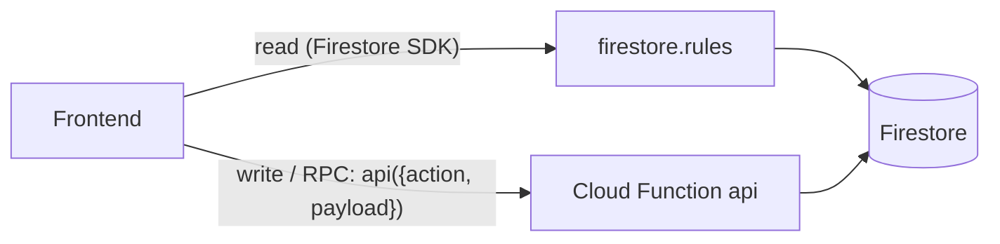

# Firebase

**Setup guide:** [firebase-setup](firebase-setup.md).

**Purpose:** Firestore storage plus one callable Cloud Function (`api`) for identity (users, roles, claims), device management and expense tracking. It mirrors the [Supabase](supabase.md) schema and rules; the frontend picks it with a config change. Code: [backend/firebase](../firebase).

## Contract

- **Collections** use the Supabase table names: `users`, `roles`, `claims`, `user_roles`, `role_claims`, `user_claims`, `categories`, `equipment`, `maintenance_logs`, `payment_methods`, `fixed_expense_templates`, `expenses`. Document id = UUID, except `payment_methods` (the client-chosen text id), and the join/claim documents, whose ids are derived (`<user_id>_<role_id>`, `<role_id>_<sha256(key\nvalue)>`, `<user_id>_<sha256(key\nvalue)>`, claims: `sha256(key\nvalue)`). Fields are the Postgres snake_case columns. `null` is stored explicitly for empty values.
- **Datetimes** are UTC ISO strings with milliseconds and `+00:00` (`2026-10-16T08:00:00.123+00:00`). Dates (`purchase_date`, `spent_on`, `warranty_expiry_date`) are `YYYY-MM-DD`.
- **Audit** (server-filled, client values ignored, actor = verified token email): device tables `created_at`, `modified_at`, `created_by`, `last_modified_by`; identity and expense tables `created`, `created_by`, `last_modified`, `last_modified_by`.
- **Reads** go straight to Firestore. [firestore.rules](../firebase/firestore.rules) allow a read only with Google sign-in (verified email, provider `google.com`), an active user, and the claim `permission=device.mgt.read` / `expense.read` / `identity.read` (`users` also allow reading the caller's own row). The `super` role bypasses. **All writes are denied in rules** (`allow write: if false`); only the function writes (Admin SDK).
- **Writes and RPCs**: one callable HTTPS function `api`, request `{ action: string, payload: object }`. Success returns the data. Failure throws `HttpsError` and the stable code is in `error.details.code`. Callable status by kind: validation `invalid-argument`, rule violation `failed-precondition`, `not-found`, `permission-denied`, `unauthenticated`, stale `expected_last_modified` `aborted` (code `conflict`), anything unexpected `internal` (code `internal`, no details).
- **Access index**: rules cannot query or aggregate, so the function maintains `access_index/{lowercase email}` = `{ user_id, active, is_super, permissions[] }` (permission values of the effective claims). Clients may read only their own document; nobody writes it from a client. It is refreshed right after each identity write and is idempotent. Authorization inside the function never uses it: it recomputes access from users, roles and claims, so revocation there is immediate. If a refresh ever fails, repeat the same action or run the seed script, which rebuilds the super user entry.

## Actions

Names reuse the Apps Script actions (`<module>.<entity>.<action>`); Supabase-only RPCs are `access-control.identity.current`, `access-control.access.preview`, `expense-tracking.expense.generate-fixed`. List/get actions do not exist: read Firestore directly. Optional `expected_last_modified` (the audit value the client saw) turns a stale update into `conflict`. Audit fields in responses are included. `Ok` = `{}`.

| Action | Needs | Payload | Result |
|---|---|---|---|
| `access-control.identity.current` | signed-in Google user | none | `{ email, role, roles, claims:[{key,value}] }` or `null` (unknown/inactive) |
| `access-control.access.preview` | `identity.read` | `user_id` | same shape for that user (target may be inactive); `not_found` |
| `claims.claim.create` / `.delete` | `identity.write` | `key`, `value` | `{key,value}` / Ok |
| `roles.role.create` | `identity.write` | `name`, `description?` | Role |
| `roles.role.update` | `identity.write` | `id`, `name`, `description?`, `expected_last_modified?` | Role |
| `roles.role.delete` | `identity.write` | `id` | Ok |
| `roles.roleClaim.add` / `.remove` | `identity.write` | `role_id`, `key`, `value` | Role |
| `users.user.create` | `identity.write` | `email`, `active?`, `role_ids?` | User |
| `users.user.update` | `identity.write` | `id`, `email`, `active?`, `expected_last_modified?` | User |
| `users.user.delete` | `identity.write` | `id` | Ok |
| `users.userRole.assign` / `.unassign` | `identity.write` | `user_id`, `role_id` | User |
| `users.userClaim.add` / `.remove` | `identity.write` | `user_id`, `key`, `value` | User |
| `device-management.category.create` | `device.mgt.write` | `name`, `parent_id?` | Category |
| `device-management.category.update` | `device.mgt.write` | `id`, `patch:{name?, parent_id?}` (null/'' = root) | Category |
| `device-management.category.remove` | `device.mgt.write` | `id` | Ok |
| `device-management.equipment.create` | `device.mgt.write` | `name`, `category_id?`, `description?`, `status?`, `quantity?`, `purchase_date?`, `warranty_months?`, `note?`, `vendor?` | Equipment |
| `device-management.equipment.update` | `device.mgt.write` | `id`, `patch` (same fields, only present keys change) | Equipment |
| `device-management.equipment.remove` | `device.mgt.write` | `id` | Ok (its logs are removed too) |
| `device-management.maintenance.add` | `device.mgt.write` | `equipment_id`, `type`, `performed_at?`, `note?`, `vendor?` | MaintenanceLog |
| `expense-tracking.expense.create` | `expense.write` | `description`, `amount`, `payment_method_id`, `spent_on`, `statement_month?`, `is_fixed?` | Expense |
| `expense-tracking.expense.update` | `expense.write` | `id`, any create field, `expected_last_modified?` | Expense |
| `expense-tracking.expense.delete` | `expense.write` | `id` | Ok |
| `expense-tracking.expense.markPaid` / `.markUnpaid` | `expense.write` | `id` | Expense (`paid_at` = now / `null`) |
| `expense-tracking.expense.generate-fixed` | `expense.write` | `statement_month` (`YYYY-MM`) | `{ items: Expense[] (only the created ones), skipped }` |
| `expense-tracking.paymentMethod.create` | `expense.write` | `id`, `name`, `active?`, `statement_closing_day?`, `color?` | PaymentMethod |
| `expense-tracking.paymentMethod.update` | `expense.write` | `id`, `name?`, `active?`, `statement_closing_day?`, `color?`, `expected_last_modified?` | PaymentMethod |
| `expense-tracking.paymentMethod.delete` | `expense.write` | `id` | Ok |
| `expense-tracking.fixedTemplate.create` | `expense.write` | `description`, `amount?`, `payment_method_id?`, `total_months?`, `payment_day?`, `active?` | Template |
| `expense-tracking.fixedTemplate.update` | `expense.write` | `id`, any create field, `expected_last_modified?` | Template |
| `expense-tracking.fixedTemplate.delete` | `expense.write` | `id` | Ok |

Response shapes: `User` = user row + `role_ids[]` + own `claims[]`; `Role` = role row + `claims[]`; the others are the stored document (plus audit). An unknown action is `unknown_action`, a malformed payload `invalid_request`, a missing permission `forbidden`, a missing or non-Google login `unauthenticated`.

## Rules and codes

Every rule of the Supabase scripts is implemented in the `domain` layer and checked inside one Firestore transaction per aggregate.

- **Identity**: email trimmed, lowercase, no `/` (`user_email_invalid`, `user_email_duplicate`); role name `^[a-z][a-z0-9_-]{1,31}$` (`role_name_invalid`, `role_name_duplicate`), description <= 200; claim key/value (`claim_key_invalid`, `claim_value_invalid`, `claim_duplicate`, `claim_unknown`, `claim_in_use`); `super` cannot be renamed or deleted (`role_protected`), a role with users cannot be deleted (`role_in_use`); `last_super` and `self_lockout` guard deactivating, deleting, unassigning `super` and changing the email of the caller's own super row; limits 20 roles per user, 100 claims per user or role, 1000 rows per users/roles/claims (`limit_exceeded`). Effective claims merge additively, sorted by key then value.
- **Device management**: categories have unique sibling names, case-insensitive (`category_name_required`, `category_name_duplicate`), no cycles (`category_cycle`), delete is restricted (`category_has_children`, then `category_in_use`); `category_id`/`parent_id` that do not exist are `not_found`. Equipment: `status` `active|in_repair|retired`, `quantity` integer >= 0, blank `note`/`vendor` become `null` (max 2000/200: `note_too_long`, `vendor_too_long`), `purchase_date` real date (`purchase_date_invalid`), `warranty_months` 0..600 (`warranty_months_invalid`) and requires a purchase date (`warranty_requires_purchase_date`); `warranty_expiry_date` is server-computed (purchase date + months, clamped to month end) and never read from the client. Maintenance `type` `new|repair|replacement|maintenance` (`maintenance_type_invalid`), `performed_at` blank = now (`performed_at_invalid`).
- **Expense tracking**: amount positive integer (`amount_invalid`, `expense_amount_required`), pending (null) amount and payment method only on template-generated rows and never cleared again (`expense_payment_method_required`), `paid_at` only on fixed expenses (`expense_not_fixed`), `statement_month` `YYYY-MM` (`statement_month_invalid`), defaulted from the payment method closing day when omitted and never recomputed on update; `payment_day` 1..31 (`payment_day_invalid`), `total_months` >= `months_added` (`total_months_below_added`, `months_added` is server-owned); payment method id `^[a-z0-9_-]{1,40}$` (`payment_method_id_invalid`, `payment_method_id_taken`), unique name (`payment_method_name_taken`), color `#rrggbb` (`payment_method_color_invalid`), closing day 1..31 (`payment_method_closing_day_invalid`), delete restricted (`payment_method_in_use`), unknown reference `payment_method_not_found`. Deleting a template clears `template_id` on its expenses, or fails with `template_has_pending_expenses` when one is still pending.
- **generate-fixed**: for each active template with months left and no expense yet for the month it creates a fixed expense (`spent_on` = payment day capped to the month length, the 1st when none; `statement_month` = the requested month) and increments `months_added`, in one transaction. The expense id is derived from (template, month), so repeated or concurrent runs create nothing twice. It does not add the `[n/total]` description suffix (same as the SQL function).

## Layout

`functions/src`: `shared/` (clock, id generator, audit stamping, auth caller and access types, router, validation, errors, Firestore transaction helper), `modules/{identity,device-management,expense-tracking}/{domain,application,endpoints,persistence/firestore}`, [composition.ts](../firebase/functions/src/composition.ts) (wiring, the only place that knows every module) and [index.ts](../firebase/functions/src/index.ts) (exports `api`). Application code depends only on ports (`IdentityStore`, `DeviceStore`, `ExpenseStore`, `Clock`, `IdGenerator`); Firestore code lives in `persistence/firestore`. Seed: [scripts/seed.ts](../firebase/functions/scripts/seed.ts).

## Limits

- Name uniqueness (category siblings, role names, payment method names) is checked inside the transaction by reading the candidate documents; two perfectly simultaneous creates of the same name could in theory both pass.
- Equipment delete and generate-fixed stay under Firestore's 500 writes per transaction (generate-fixed refuses more than 240 due templates with `limit_exceeded`).
- No list/get/paging actions: the client queries Firestore (composite indexes in [firestore.indexes.json](../firebase/firestore.indexes.json)).
- Existing Supabase or Sheets data is not migrated by this backend.
