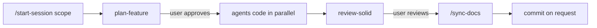

# Claude workflow guide

How to work with Claude Code in this repo. Rules live in [CLAUDE.md](../CLAUDE.md); this page is the quick guide.

## Files

| Kind | Location | Purpose |
|------|----------|---------|
| Rules | `CLAUDE.md` | Working rules, architecture, clean code, SOLID |
| Agents | `.claude/agents/` | `architect`, `frontend-dev`, `data-adapter-dev`, `apps-script-dev`, `solid-reviewer`, `docs-writer` |
| Skills | `.claude/skills/` | `plan-feature`, `add-module`, `add-data-adapter`, `review-solid`, `write-docs`, `run-tests` |
| Commands | `.claude/commands/` | `/start-session`, `/sync-docs` |
| Settings | `.claude/settings.json` | Permissions, attribution disabled |

Claude files are committed on `core/agents` first, then merged into `dev` and feature branches.

## Typical session

1. **`/start-session frontend|backend|full`**: loads the repo state, module list, docs index and entry points for the scope (headings only, no module internals).
2. **Plan** (`plan-feature`, or `add-module` for a new module). For a big task with a long session, Claude asks you to confirm before any compact: compact, clear and restart with `/start-session`, or continue. Claude never compacts silently.
3. **Code** through the dev agents with disjoint file scopes. Nothing is coded before the plan is approved.
4. **Review** with `review-solid`, then you review. Tests run only when you ask (`run-tests`).
5. **`/sync-docs`**: summarizes the session, checks it against `git diff`, and updates `frontend/docs/<module>.md` and `backend/docs/<module>.md` through `docs-writer`.
6. **Commit** only when you ask (Conventional Commits, no attribution).

## Context discipline

- Agents read only their assigned scope (Grep, then offset/limit), never re-read files or CLAUDE.md, and report in at most 10 lines without pasting code.
- `docs-writer` and `solid-reviewer` run on `sonnet`; every agent has a `maxTurns` limit.
- Skills delegate to the agent that owns the rules instead of repeating them.
