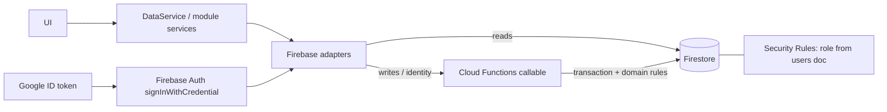

# Plan: Firebase as the third data provider

Status: **proposed, awaiting approval** (no code written yet).

Decisions already made by the user:
- Enforcement: Firestore Security Rules + Cloud Functions (Blaze plan).
- Scope: all modules (device-management, claims, roles, users, access-control).
- Auth: Firebase Auth with Google (`signInWithCredential`), email allowlist in the `users` collection.

Still open: Firestore region (default proposal `asia-southeast1`).

## Goal and non-goals

**Goal:** `VITE_DB_PROVIDER=firebase` works for every module with the same semantics as Supabase (errors, ordering, pagination). Switching providers needs only a config change.

**Non-goals:**
- No data migration tool between Sheets, Supabase and Firebase.
- No offline or realtime listeners.
- No Firebase Hosting (the app stays on GitHub Pages / Cloudflare Pages).
- No change to the Sheets or Supabase code.

## Key design decision

Firestore has no triggers, foreign keys or unique constraints. Supabase enforces its rules with about 1000 lines of SQL (`backend/supabase/migrations/001-007`).

| Supabase mechanism | Firebase replacement |
|---|---|
| RLS + `current_app_role()` | Security Rules: `get(/users/{emailKey})` for the role, with `request.auth.token.firebase.sign_in_provider == 'google.com'` and `email_verified` |
| Audit trigger `set_audit_columns` | Callable Functions set `created_at`, `modified_at`, `created_by`, `last_modified_by` from the server clock; Rules deny direct client writes |
| Cycle trigger, unique sibling name, `on delete restrict`, cascade logs, admin guards | Callable Functions run the checks inside a Firestore transaction. Uniqueness uses a marker doc `categoryNames/{parentId_lowerName}`. Cascade delete is a batched delete. |
| RPCs `current_identity`, `preview_access` | Callables `identityGet`, `accessPreview` |
| Reads | Client reads Firestore directly (gated by Rules), like the Supabase adapter |

All writes go through callables; Rules deny every client write, so invariants cannot be bypassed with the SDK.

## Affected and new files

### Backend: new `backend/firebase/`

```
backend/firebase/
  firebase.json                  # firestore rules/indexes + functions config
  .firebaserc.example            # project id placeholder (real id never committed)
  firestore.rules                # read rules per role/claim, writes denied
  firestore.indexes.json         # equipment (modified_at desc, id), logs (performed_at desc)
  functions/
    package.json, tsconfig.json
    src/
      index.ts                   # exports callables only
      shared/                    # clock, id-generator, audit, auth-context, error -> code mapping
      domain/                    # pure rules: category cycle, name rules, admin invariants
      modules/device-management/ # category / equipment / maintenance commands
      modules/{claims,roles,users,access-control}/
backend/docs/firebase.md         # setup step by step with real values, no secrets
```

### Frontend: `persistence/firebase/` per module

- `shared/firebase/firebase-client.ts`: creates app, auth, firestore, functions (in-memory auth persistence).
- Adapters: `FirebaseAdapter` (device-management), `ClaimFirebaseRepository`, `RoleFirebaseRepository`, `UserFirebaseRepository`, `AccessPreviewFirebaseRepository`, `FirebaseSessionAdapter`.
- `app/build-firebase-client.ts`, `app/env.ts`, `app/data-service-factory.ts`, `app/build-auth.ts`.
- Each module's `create-*-service.ts` and the `ProviderConfig` union gain a `firebase` case.
- Docs: `frontend/docs/*.md`, `config.md`, `deploy.md`, `README.md`, deploy workflow env vars.

Sheets and Supabase folders stay untouched.

## Interfaces and signatures

```ts
// env.ts
DB_PROVIDERS = ['sheets', 'supabase', 'firebase']
AppEnv += { firebaseApiKey, firebaseAuthDomain, firebaseProjectId, firebaseAppId, firebaseFunctionsRegion }

// per-module config union gains:
{ provider: 'firebase'; app: FirebaseApp }   // same pattern as { provider: 'supabase'; client }

// session
class FirebaseSessionAdapter implements SessionProvider {
  establish(idToken, nonce): Promise<Identity>   // signInWithCredential(GoogleAuthProvider.credential(idToken)) -> callable identityGet
  clear(): Promise<void>
}
```

- Callable names follow the namespacing: `deviceManagement-category-create`, `identity-user-update`, ...
- Callables return `{ ok, data }` or an `HttpsError` carrying the stable codes (`category_cycle`, `category_name_duplicate`, `category_in_use`, ...).
- Error mapping to typed errors happens in the adapter, identical to the other adapters.
- Nonce: `signInWithCredential` takes no nonce parameter. Verify during implementation; if needed, validate the nonce inside `identityGet`.

## Data flow



## SOLID and provider-independence check

- **O:** a new `persistence/firebase` folder per module; other providers are not edited.
- **L:** same ordering as Supabase (equipment `modified_at` DESC then `id` ASC; logs `performed_at` DESC then `id` ASC), same cursor pagination, same UTC ms `+00:00` datetime strings.
- **D:** UI and services see only ports; the factory is the only place that knows `firebase`.
- Collection and field names match the Sheets headers and Postgres columns (snake_case, audit columns on every collection).

## Security checklist

- No service-account key or admin key in the frontend or `VITE_*`. The Firebase web config is public by design; protection comes from Rules and Functions.
- Rules: default deny. Reads need a Google login, a verified email and an active allowlisted user. All client writes denied.
- Optional hardening: Firebase App Check.
- Firebase console: disable every sign-in provider except Google, restrict the API key by HTTP referrer, minimal IAM for the Functions service account.
- Functions return generic errors and never log the ID token or email.

## Risks and open questions

1. **Blaze plan** is required to deploy Functions (free tier, but needs billing).
2. **Cost and latency:** cold starts of 1-2 s on writes; the Rules `get()` role lookup bills one read per evaluation. Mitigation if needed: set a `role` custom claim at login (follow-up decision).
3. **Uniqueness** relies on marker docs written in transactions: correct but needs careful tests.
4. **Rules cannot count or join:** all in-use checks (`category_in_use`, role in use, last admin) live only in Functions.
5. **Region and Firestore mode:** region still to be chosen; Native mode assumed.
6. No `phase2` equivalent: Firebase starts clean.
7. **Tests:** unit tests for pure domain rules and adapter mapping are included, but per project rules none run until the user asks.

## Ordered task list

1. Scaffold `backend/firebase/` (config, `.firebaserc.example`, indexes).
2. Write `firestore.rules`: users/role lookup helper and per-collection read rules.
3. Functions shared kernel: clock, id, audit, auth-context, error codes.
4. Functions device-management: category, equipment, maintenance commands with the domain rules.
5. Functions identity: users, roles, claims, `identityGet`, `accessPreview`, admin invariants from migrations `006`/`007`.
6. `backend/docs/firebase.md` with setup steps (project, Google provider, Blaze, deploy, first admin seed).
7. Frontend: `firebase-client.ts`, env parsing, `build-firebase-client`.
8. Frontend adapters in order: device-management, session/auth, access-preview, roles, claims, users.
9. Wire the factory and each `create-*-service` switch.
10. Frontend docs, README, deploy workflow env vars.
11. Stop for user review. Reviews and tests run only on request.

### Agent split (parallel where independent)

- Tasks 1-6 (Functions and Rules): `apps-script-dev` or a general agent.
- Tasks 7-10 (frontend adapters): `data-adapter-dev`.
- Docs: `docs-writer`.

## Approval

Reply "approve" with the Firestore region (or "default asia-southeast1") to start implementation.
