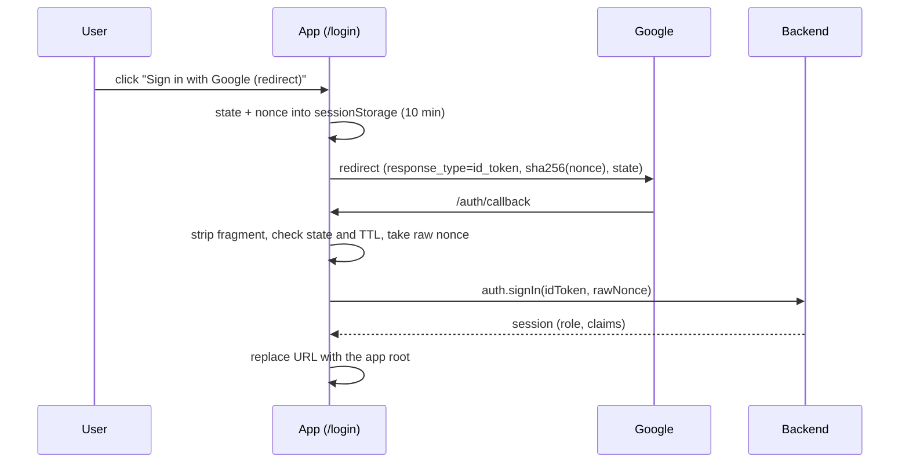

# access-control (frontend)

Google sign-in, the signed-in caller's roles and claims, and the admin access preview. It replaces the former `auth` module. Backend counterpart: [backend/docs/access-control.md](../../backend/docs/access-control.md). Related: [claims](claims.md), [roles](roles.md), [users](users.md), [launcher](launcher.md).

## Public API ([index.ts](../src/modules/access-control/index.ts))

- `createAuthService(config)` returns `{ auth, renderSignInButton, redirectLogin }`; `buildAuth(env, supabaseClient)` ([build-auth.ts](../src/app/build-auth.ts)) calls it once in [main.tsx](../src/main.tsx), which first runs [consume-auth-callback.ts](../src/app/consume-auth-callback.ts) and then passes all three to `AuthGate`.
- `AuthService`: `signIn(idToken, nonce)`, `restoreSession`, `silentFailure`, `signOut`, `current`, `getIdToken`, `getRole`, `subscribe`, `refreshIdToken`, `attempts` (pending or failed sign-in, read by the login page).
- Types: `Identity` and `Session` (`email`, `role`, `roles: string[]`, `claims: Claim[]`; `Session` adds the token), `Role` (`admin` | `viewer`), `EffectiveAccess` (same fields, but `role` may be `''`: only a preview of a role-less user shows it, a real sign-in is refused). `hasClaim` and `Claim` are re-exported from [claims](claims.md).
- `AccessPreviewService.preview(userId)` and `createAccessPreviewService(config)`: calls `access-control.access.preview` (Sheets) or the `preview_access` RPC (Supabase); admin only.
- UI: `AuthGate`, `UserMenu`, `CurrentUserBadge`, hooks `useSession`, `useRole`, `useCanWrite`. Device-management uses `useCanWrite` to hide write controls from viewers.
- Factories take a `ProviderConfig` ([provider-config.ts](../src/shared/api/provider-config.ts)): `{ provider: 'sheets', apiUrl, getIdToken, refreshIdToken? }` or `{ provider: 'supabase', client }`. The caller (composition root) decides the URL, so the Identity services use `VITE_IDENTITY_API_URL` while device-management uses `VITE_SHEETS_API_URL`.

## Flow

1. `AuthGate` wraps the whole app. With no session it calls `auth.restoreSession()`: a silent Google re-login (loading state) that is not retried. If it fails (`timeout`, `load_error`, or `unavailable` when Google will not prompt, e.g. dismissed or cooldown), `LoginPage` shows a neutral hint for the cause (`auth.silent*` messages) above the Google button.
2. The Google ID token goes to the provider adapter (identity-api `auth.session.get`, or Supabase `signInWithIdToken`), which returns email, role, role names and effective claims.
3. The token lives in memory only and is refreshed before it expires; adapters read it through `getIdToken`.
4. On `UNAUTHORIZED` the shared [SheetsCaller](../src/shared/api/sheets-caller.ts) calls `refreshIdToken()` once and retries once; with no new token the session ends and the gate shows the login page.
5. A failed background refresh keeps the session until the token expires; it is cleared at once only on `AuthError` or `ForbiddenError`.
6. After sign-in the gate keeps rendering its children at the same route, so the route present before sign-in (the return URL) is restored with no query parameter. On sign-out [reset-route-on-sign-out.ts](../src/app/reset-route-on-sign-out.ts) navigates to `/` (replace).
7. `CurrentUserBadge` opens the settings menu; `UserMenu` shows email, role and a sign-out button with a pending state.

## Rules and limits

- UI roles are a convenience; the backend (identity-api check or Supabase RLS) enforces access.
- A non-allowlisted, inactive or role-less account gets `ForbiddenError` on the login page.
- No token or session is stored in web storage; a reload needs the silent re-login. It can fail where One Tap cannot run (third-party cookies blocked, private window, prompt dismissed): the user then clicks the Google button once. `IdTokenSource.lastFailure()` carries the cause.
- Nonce: each Google initialize gets a random nonce; Google gets `sha256(nonce)`, the backend gets the raw nonce (`payload.nonce` of `auth.session.get`, or `signInWithIdToken`). Only the sign-in call carries it.
- Needs `VITE_GOOGLE_CLIENT_ID` and, for Sheets, `VITE_IDENTITY_API_URL`.
- An older backend that omits `roles`/`claims` still signs users in (they default to empty).
- `postToAppsScript` aborts after 45 s; the first request after sign-in runs alone through [WarmupGate](../src/shared/api/warmup-gate.ts).
- `NetworkError` carries a fixed message; server or browser error text is never kept.
- Conflict handling for the admin screens lives in [conflict.ts](../src/modules/access-control/ui/conflict.ts); route helpers for the Identity app are in [identity-routes.ts](../src/modules/access-control/ui/identity-routes.ts).

## Redirect sign-in (fallback to One Tap)

Shown on the login page under the Google button (emphasized with a hint when the silent sign-in failed). It works where One Tap cannot (third-party sign-in blocked, dismissed prompt). Code: [GoogleRedirectClient](../src/modules/access-control/infrastructure/google-redirect-client.ts) behind the `RedirectLogin` port; the button is [google-redirect-button.tsx](../src/modules/access-control/ui/google-redirect-button.tsx). It copies the look of Google's own button (white outline, G logo, 15rem wide, `.btn-google` in [components.css](../src/styles/components.css)). The Google button is drawn by Google in an iframe and keeps its own width; a fixed `width` option stretches the personalized variant and pushes its logo away from the text, so none is set.

- Redirect URIs must be registered: see [google-oauth-setup](../../backend/docs/google-oauth-setup.md). The URI is derived from `origin + BASE_URL + auth/callback`; there is no env var.
- The backend is unchanged: the same `(idToken, rawNonce)` pair as One Tap.
- The fragment is removed from the address bar as the first synchronous step. [404.html](../404.html) keeps the fragment out of `?p=`, so the token never reaches a server in a query string.
- `state` is compared in constant time and is one-shot; the pending entry is deleted when read, on sign-out, and expires after 10 minutes. Errors are generic (`auth.redirectFailed`, `auth.redirectStateMismatch`); Google error text is never shown or logged.
- If `sessionStorage` is unavailable the flow does not start and shows a generic error.
- Limits: no silent renew after a reload (no `prompt=none`), and the token lasts about 1 hour with no refresh, so the user signs in again afterwards.
