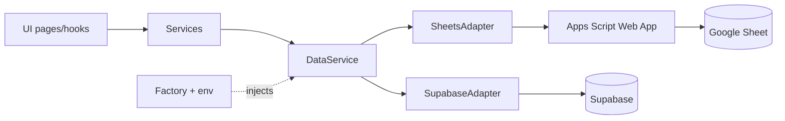

# Config

Env parsing and the provider factory. Switching data source is a config change only.

## Env vars

| Var | Used by |
|---|---|
| `VITE_DB_PROVIDER` | `sheets`, `supabase` or `firebase` (required) |
| `VITE_SHEETS_API_URL` | `sheets` provider |
| `VITE_IDENTITY_API_URL` | `sheets` provider: Apps Script web app answering `auth.session.get`; ignored by `supabase` |
| `VITE_EXPENSE_API_URL` | `sheets` provider: Apps Script web app of the expense-tracking module ([expense-tracking](expense-tracking.md)); ignored by `supabase` |
| `VITE_GOOGLE_CLIENT_ID` | Google login (all providers) |
| `VITE_SUPABASE_URL`, `VITE_SUPABASE_ANON_KEY` | `supabase` provider |
| `VITE_FIREBASE_API_KEY`, `VITE_FIREBASE_AUTH_DOMAIN`, `VITE_FIREBASE_PROJECT_ID`, `VITE_FIREBASE_APP_ID` | `firebase` provider (public web config, not secrets; access is enforced by Firestore rules and the callable) |
| `VITE_FIREBASE_FUNCTIONS_REGION` | `firebase` provider, optional (default Functions region) |
| `VITE_BASE_PATH` | Vite `base` (default `/`) |

[readEnv](../src/app/env.ts) validates the provider and throws `ConfigError` if invalid. Missing provider-specific values make the factory throw `ConfigError`; [main.tsx](../src/main.tsx) logs the error to the console and renders `StartupError` (a [FatalError](../src/shared/components/fatal-error.tsx) with fixed, translated text, never the raw message) instead of a blank page. The React `ErrorBoundary` does the same for render errors. Use a `.env` file for the opt-in contract tests (`npm run test:contract`).

## Factory

[buildSupabaseClient](../src/app/build-supabase-client.ts) and [buildFirebaseApp](../src/app/build-firebase-app.ts) create the single Supabase client or Firebase handle (only for their provider; the handle wraps Firestore, Auth and the `api` callable via [firebase-client.ts](../src/shared/firebase/firebase-client.ts), whose `callApi` rejects with an error carrying only the backend `code`). `main.tsx` passes them explicitly to `buildAuth` and `buildServices`. Module factories take a `ProviderConfig` with `{ provider: 'firebase', handle }`. [createDataService](../src/app/data-service-factory.ts) builds the provider config and returns a `DataService`. [buildServices](../src/app/build-services.ts) wraps it in `CategoryService`, `EquipmentService` and `MaintenanceService`; [main.tsx](../src/main.tsx) passes them through `ServicesProvider`.

## Add a provider

1. Implement `DataService` in `src/modules/device-management/infrastructure/persistence/<name>/` (see [device-management](device-management.md)).
2. Add the name to `DB_PROVIDERS` in `env.ts` and any new env vars to `AppEnv`.
3. Add one entry to the builders map in the factory.

No existing adapter or UI code changes.

## Base path

[vite.config.ts](../vite.config.ts) sets `base` from `VITE_BASE_PATH`. The workflow detects it from the Pages settings (`/` with a custom domain, `/<repo>/` on `github.io`); the repository variable `VITE_BASE_PATH` overrides it. Cloudflare Pages and local dev use `/`. See [deploy](deploy.md).

## Data flow

