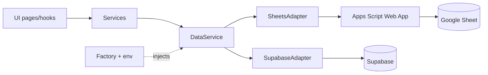

# Config

Env parsing and the provider factory. Switching data source is a config change only.

## Env vars

| Var | Used by |
|---|---|
| `VITE_DB_PROVIDER` | `sheets` or `supabase` (required) |
| `VITE_SHEETS_API_URL`, `VITE_SHEETS_API_TOKEN` | `sheets` provider |
| `VITE_SUPABASE_URL`, `VITE_SUPABASE_ANON_KEY` | `supabase` provider |
| `VITE_BASE_PATH` | Vite `base` (default `/`) |

[readEnv](../src/app/env.ts) validates the provider and throws `ConfigError` if invalid. Missing provider-specific values make the factory throw `ConfigError`; [main.tsx](../src/main.tsx) shows the message through `StartupError` instead of a blank page. Use a `.env` file for the opt-in contract tests (`npm run test:contract`).

## Factory

[createDataService](../src/app/data-service-factory.ts) picks a builder from a map keyed by provider and returns a `DataService`. [buildServices](../src/app/build-services.ts) wraps it in `CategoryService`, `EquipmentService` (which uses the category service to expand descendants) and `MaintenanceService`; [main.tsx](../src/main.tsx) passes them through `ServicesProvider`.

## Add a provider

1. Implement `DataService` in `src/modules/device-management/infrastructure/persistence/<name>/` (see [device-management](device-management.md)).
2. Add the name to `DB_PROVIDERS` in `env.ts` and any new env vars to `AppEnv`.
3. Add one entry to the builders map in the factory.

No existing adapter or UI code changes.

## Base path

[vite.config.ts](../vite.config.ts) sets `base` from `VITE_BASE_PATH`. GitHub Pages needs `/<repo>/` (set by the workflow); Cloudflare Pages and local dev use `/`. See [deploy](deploy.md).

## Data flow

