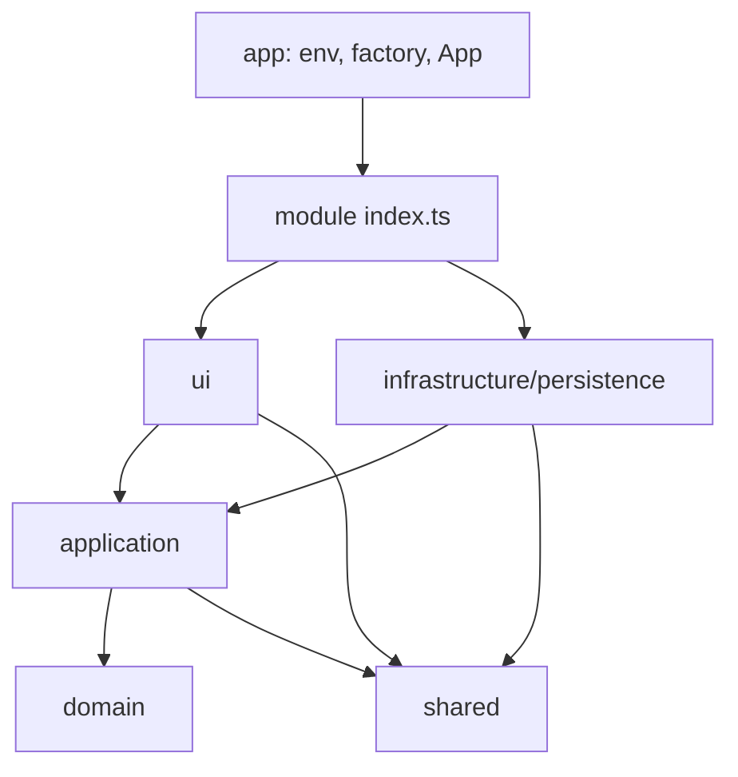

# Device management module

Bounded context for equipment, maintenance logs and categories. It owns its model end to end: domain, use cases, persistence for each provider, and UI. Code: [modules/device-management](../src/modules/device-management). Backend counterpart: `backend/docs/device-management.md`.

## Public API

Other code imports only from [index.ts](../src/modules/device-management/index.ts):
- Types and services: `DataService`, `CategoryService`, `EquipmentService`, `MaintenanceService`.
- Composition: `createDeviceManagementDataService(config)` (`DataServiceConfig` = sheets | supabase); adapter classes are internal.
- Domain rules (equipment/maintenance validation, category cycle, selectable parents) live in `domain/`; services, UI and the `testing/in-memory-data-service` fake reuse them.
- UI: `ServicesProvider`, `Services`, `CategoriesProvider`, `CategoriesPage`, `EquipmentListPage`, `EquipmentDetailPage`.
- Navigation: `CATEGORIES_PATH`, `navigate`, `parseEquipmentId`.

## Layers and dependency rules

- `domain`: entities and pure rules, no dependencies.
- `application`: repository ports, `DataService`, services (use cases). Depends on domain only.
- `infrastructure/persistence/{googlesheet,supabase,contract}`: one folder per provider, plus shared row mappers; `contract` holds the shared test suite.
- `ui`: pages, components, contexts; calls services from context, never `fetch` or the Supabase client.
- `shared/`: errors, `Page`, UTC helper, i18n, async hooks, generic components. It never imports modules.
- `app/`: the only place that knows all modules and wires adapter to services ([data-service-factory.ts](../src/app/data-service-factory.ts), [build-services.ts](../src/app/build-services.ts)); see [config](config.md).

## Domain

- [Equipment](../src/modules/device-management/domain/equipment.ts): `Equipment`, `NewEquipment`, `EQUIPMENT_STATUSES` (`active`, `in_repair`, `retired`).
- [Category](../src/modules/device-management/domain/category.ts): `parentId` `""` is a root; `validateCategoryName` trims and requires a name (`category_name_required`). At most two levels (category > sub category, `MAX_CATEGORY_DEPTH = 2` in category-tree.ts). Legacy deeper data still renders nested. `Equipment.categoryId` `""` means uncategorized.
- [MaintenanceLog](../src/modules/device-management/domain/maintenance.ts): `MAINTENANCE_TYPES` (`new`, `repair`, `replacement`, `maintenance`).
- [category-tree.ts](../src/modules/device-management/domain/category-tree.ts): pure, cycle-safe helpers `buildTree` (orphans become roots), `flattenTree`, `getPath`, `formatPath`, `getDescendantIds`, `isDescendant`, `selectableParents`, `assertNotOwnParent` and `assertNoCategoryCycle` (`category_cycle`), `assertWithinDepthLimit` (`category_depth_exceeded`), `selectableRootParents` (parent picker: roots only).
- Dates are UTC ISO strings with `+00:00` offset; ids are UUIDs. All models carry server-filled audit fields `createdAt`, `modifiedAt`, `createdBy`, `lastModifiedBy` (`*By` is `''` until login exists); `New*` types exclude them.
- Errors in [errors.ts](../src/shared/errors.ts): `NotFoundError`, `ValidationError` (stable `code`, e.g. `name_required`, `category_cycle`, `category_in_use`, `category_has_children`), `AuthError`, `NetworkError`.

## Application

[DataService](../src/modules/device-management/application/data-service.ts) = `EquipmentRepository & MaintenanceRepository & CategoryRepository` (small ports; category methods carry a suffix to avoid name clashes).

| Repository | Methods |
|---|---|
| Equipment | `list(query)`, `get(id)` (null if missing), `create`, `update(id, patch)`, `remove` |
| Maintenance | `listByEquipment(equipmentId)`, `add` |
| Category | `listCategories()` (name A-Z, case-insensitive), `getCategory(id)`, `createCategory`, `updateCategory`, `removeCategory` |

- `list` takes `search`, `categoryIds` (empty = no filter), `status`, `page`, `pageSize` and returns `Page<T>`. Order is the same everywhere: equipment by `modifiedAt` DESC, maintenance by `performedAt` DESC.
- `EquipmentService`: expands `categoryId` to the category plus descendants (via `CategoryDescendants`), defaults `page = 1`, `pageSize = 12`, clamps to 1..100; `get` throws `NotFoundError` on null; `create`/`update` validate first (name trimmed and required, quantity integer >= 0, valid status).
- `CategoryService`: `validateCategoryName`; on update with a parent it loads the fresh tree and runs `assertNoCategoryCycle` then `assertWithinDepthLimit`; create runs the depth check. A third level (new/moved under a child, or moving a category that has children under another) throws `category_depth_exceeded`. The depth rule is enforced only in `CategoryService` (and the parent picker); the backend does not reject depth yet, and the in-memory fake in `testing/` (name and cycle rules only, no depth) does not either. Duplicate sibling names and blocked deletes come from the backend as the same codes.
- `MaintenanceService`: `type` in `MAINTENANCE_TYPES`, `performedAt` a parsable date, `note` trimmed.
- Validation is client-side convenience; backends enforce their own rules.

## Persistence

- [SheetsAdapter](../src/modules/device-management/infrastructure/persistence/googlesheet/sheets-adapter.ts) calls the Apps Script Web App with actions `device-management.<entity>.<action>` (see `backend/docs/apps-script.md`). [SupabaseAdapter](../src/modules/device-management/infrastructure/persistence/supabase/supabase-adapter.ts) uses the Supabase client.
- [row-mappers](../src/modules/device-management/infrastructure/persistence/row-mappers.ts) map snake_case rows to domain types for both; datetimes go through [toUtcOffsetIso](../src/shared/utc-iso.ts) so providers return identical strings; audit fields are read, never written.
- Same semantics in both (substitutable): 1-based pagination, `get` returns null when missing, `update`/`remove`/`add` on unknown ids throw `NotFoundError`, invalid input throws `ValidationError` with a code, transport failures throw `NetworkError`. Supabase maps 23505/23503 and trigger messages to the category codes; Sheets maps backend messages. Supabase converts `""` refs to NULL on write.
- Maintenance `listByEquipment` temporarily sends both `equipment_id` and `equipmentId` to the backend while the payload key is being unified; remove one when the backend settles.

## Testing

- `npm test` runs the unit tests (domain rules, services, row mappers) against the in-memory fake [InMemoryDataService](../src/modules/device-management/testing/in-memory-data-service.ts); no network. The adapter tests (`googlesheet/*.test.ts`, `supabase/*.test.ts`) are excluded from it.
- The [contract suite](../src/modules/device-management/infrastructure/persistence/contract/data-service.contract.ts) runs against the real providers and is opt-in: `npm run test:contract` (needs a `.env` with `VITE_SUPABASE_URL` + `VITE_SUPABASE_ANON_KEY`, or `VITE_SHEETS_API_URL` + `VITE_SHEETS_API_TOKEN`; the in-memory contract run is part of `npm test`). It creates and deletes real rows, so use a dedicated test sheet/project, never production.

## UI

- Hash routes (no host rewrites): `#/` list, `#/equipment/<id>` detail (remounted per id), `#/categories`. Use `navigate` from [navigation.ts](../src/modules/device-management/ui/navigation.ts), never `window.location`.
- Contexts: [ServicesProvider](../src/modules/device-management/ui/services-provider.tsx) (`useServices`), [CategoriesProvider](../src/modules/device-management/ui/categories-provider.tsx) (`useCategories`: `data`, `flat`, `pathOf`, `loading`, `error`, `reload`; every mutation reloads).
- List page: debounced search (300 ms), category (includes descendants) and status filters, any change resets to page 1; `EquipmentTable` (built on shared `DataTable`: table >= 768px, stacked labelled cards below), a "Showing X-Y of N" line (`common.showing`), skeleton, empty and error states, shared `Pager`, "Add" dialog. `EquipmentCategoryLine` / `EquipmentQuantityLine` in [EquipmentMeta](../src/modules/device-management/ui/components/equipment-meta.tsx) render the category path and quantity lines.
- Detail page: equipment and maintenance logs load independently, each with skeleton and `ErrorState`. It shows name, category, status, description, quantity and [AuditInfo](../src/modules/device-management/ui/components/audit-info.tsx) (created/modified at and by; empty author shows "unknown"). Edit opens the form; delete is a two-step inline confirm; maintenance history is followed by `MaintenanceForm` (date defaults to today, sent as noon UTC).
- Categories page: two-level shared `TreeList` (WAI-ARIA tree, see [design-system](design-system.md)) with keyboard navigation and expand/collapse all (collapsed by default; creating a sub category expands its parent and selects it; row actions in `CategoryRowActions`), add sub category (hidden on child rows), edit (rename/move; parent choices are root categories only), two-step delete with translated errors.
- Dialogs use [Modal](../src/shared/components/modal.tsx) (native `<dialog>`: focus trap, Escape unless saving, bottom sheet below 768px). `CategorySelect` is a native select with full paths and a quick-add button.
- `SystemInfoRepository.getBackendVersion()` is part of `DataService`: the Sheets adapter calls `system.version.get`; Supabase returns `null` (shown as a dash) because the browser talks to Supabase directly. The frontend version is injected at build time from `package.json` as `__APP_VERSION__`.
- Async pattern (mandatory): `useAsyncData` for reads, `useAsyncAction` for writes, `LoadingButton`, `ErrorState` with Retry, in [shared](../src/shared). Every fetch has a loading and an error state.
- Responsive: mobile-first CSS in [src/styles](../src/styles) for 360 / 768 / 1280 px; no horizontal scroll, 44px targets, `prefers-reduced-motion` respected.
- Text is localized, see [i18n](i18n.md); user data is not translated.

## Limits

No auth yet. Types are the only client schema; keep them in sync with backend columns. Nothing outside persistence may import the Supabase client or call `fetch` for data.
